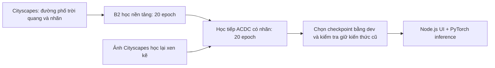

# Project-CV · Phân đoạn đường phố trong thời tiết xấu

**Đồ án ứng dụng thị giác máy tính · SegFormer-B2 · Cityscapes → ACDC · Giao diện Node.js**

[Đọc repo từng bước](docs/READING_GUIDE.md) · [Phương pháp và cấu hình](docs/RESEARCH_FRAMEWORK.md) · [Chạy Kaggle / resume](docs/TRAINING_GUIDE.md) · [Chạy giao diện](web/README.md) · [Kết quả đã kiểm tra](results/README.md)

## 1. Bài toán nói đơn giản

Đưa vào **một ảnh đường phố**, hệ thống tô màu từng vùng: đường, vỉa hè, người, xe, cây, bầu trời… Tổng cộng **19 lớp**. Mục tiêu ứng dụng là giữ khả năng phân biệt những vùng này khi ảnh có **sương mù, mưa, tuyết hoặc thiếu sáng**.

Đây là **phân đoạn ngữ nghĩa**: gán một loại cho từng pixel. Ví dụ, mọi pixel thuộc ô tô nhận lớp “car”; hệ thống chưa tách danh tính từng chiếc xe. Đầu ra gồm ảnh tô màu, ảnh chồng màu lên ảnh gốc và bản đồ mã lớp. Chất lượng cần được đo bằng ảnh có nhãn chuẩn; màu sắc trông đẹp chưa chứng minh dự đoán đúng.

## 2. Phương pháp đang dùng



- **Cityscapes** giúp model học cấu trúc đường phố và 19 lớp ban đầu.
- **ACDC** cung cấp ảnh có nhãn trong bốn điều kiện khó. Model học tiếp bằng ảnh **và nhãn ACDC train**; đây là *supervised adaptation*, không phải chỉ đem ACDC ra test và cũng không phải UDA dùng ảnh đích không nhãn.
- **Replay** là xen ảnh Cityscapes khi học ACDC để hạn chế quên cảnh trời quang.
- Xử lý ảnh, augmentation, loss, trainer và evaluator dùng chung; kiến trúc từng model có file riêng.

**Model chính:** [SegFormer-B2](src/models/segformer_b2.py), khoảng 27,36 triệu tham số. [DeepLabV3+ ResNet50](src/models/deeplabv3plus_resnet50.py), khoảng 26,70 triệu tham số, là hướng mở rộng tùy chọn, chưa có lượt train hoàn chỉnh. B0 đã rút khỏi giao diện và luồng chạy mới; [code tương thích cũ](src/models/legacy/README.md) và báo cáo lịch sử được giữ lại.

## 3. Đã làm được gì?

| Hạng mục | Trạng thái / phạm vi |
| --- | --- |
| B2 source20 → ACDC replay20, seed 42 | Đã hoàn thành và kiểm tra checkpoint |
| Cityscapes monitor 188 ảnh | B2 source: **74,74% mIoU**, best epoch 18 |
| ACDC dev nội bộ 402 ảnh | Trước thích nghi **48,44%** → sau **63,02%**, best epoch 20 |
| Giữ khả năng trên Cityscapes monitor | Sau thích nghi **74,53%**, giảm khoảng **0,21 điểm phần trăm** |
| Demo Node.js | Upload ảnh, mask/overlay, tải PNG, so sánh B2 trước/sau ACDC |
| Đánh giá chính thức Cityscapes val500 / ACDC val406 cho lượt B2 này | Chưa có kết quả nghiệm thu |
| Baseline mới dùng checkpoint Cityscapes B2 công bố | Đã thống nhất hướng; **chưa triển khai** trong notebook hiện tại |

mIoU đo mức chồng khớp dự đoán với nhãn, rồi lấy trung bình các lớp. **63,02% là điểm dev dùng chọn checkpoint**, chưa phải kết quả test độc lập và không có nghĩa mọi ảnh upload đều đúng 63,02%. Chi tiết tại [báo cáo B2](results/segformer_b2_seed42/README.md).

[SegFormer, NeurIPS 2021](https://arxiv.org/abs/2105.15203) là nguồn kiến trúc. Bài gốc báo B2 **81,0% single-scale / 82,2% multi-scale trên Cityscapes val**, với recipe và cách suy luận khác. Đó là mốc tham khảo trên Cityscapes, **không thể đặt cạnh điểm ACDC dev để kết luận hơn/kém**. Xem [ghi chú bài gốc](research/paper_reviews/SegFormer_2021.md). Đóng góp ứng dụng của đồ án là tích hợp, thích nghi, đánh giá và trình diễn hệ thống; hiện chưa khẳng định kiến trúc mới hoặc vượt bài báo.

## 4. Bắt đầu đọc và chạy

**Muốn hiểu repo:** đọc [hướng dẫn từng bước](docs/READING_GUIDE.md). Hướng dẫn nối bài toán → nhãn → dữ liệu → model → training → kiểm thử → giao diện, kèm câu hỏi cần trả lời ở mỗi bước.

**Muốn chạy demo local:** cần Python 3.11, Node.js 22+, môi trường Python của project và weights B2. Git không chứa dataset hoặc weights.

```powershell
python -m venv .venv
.venv/Scripts/python.exe -m pip install -r requirements.txt
npm start
```

Mở [WeatherLens Studio](http://127.0.0.1:3000). Demo chạy inference bằng CPU; GPU dùng trên Kaggle khi training. Máy mới clone cần đặt checkpoint theo [hướng dẫn web](web/README.md); thiếu weights thì giao diện vẫn mở nhưng chưa phân đoạn được. Dataset chỉ cần cho ảnh mẫu và train/evaluation; người dùng có thể upload ảnh riêng khi đã có weights.

**Muốn training:**

```powershell
.venv/Scripts/python.exe -m scripts.build_kaggle_notebooks
```

Upload `outputs/kaggle/project-code.zip`, Cityscapes và ACDC vào Kaggle. Import [notebook B2](notebooks/02_train_segformer_b2.ipynb), bật GPU/Internet, sửa input nếu tự tìm không rõ. Mỗi notebook chạy **một model**, source20 rồi adapt20, có checkpoint và ZIP sau mỗi epoch hoàn thành. Đọc [hướng dẫn train/resume](docs/TRAINING_GUIDE.md) trước khi chạy; notebook hiện tại vẫn dùng recipe ImageNet → Cityscapes → ACDC ở trên.

## 5. Bản đồ repo

| Thư mục | Chứa gì? | Bắt đầu ở đâu? |
| --- | --- | --- |
| `src/data/` | Nhãn, chia tập, ghép ảnh–mask, xử lý và replay | [dataset.py](src/data/dataset.py) |
| `src/models/` | Kiến trúc riêng và bộ chọn model | [README](src/models/README.md) |
| `src/training/` | Loss, optimizer, BatchNorm, trainer, lưu/khôi phục | [train.py](src/training/train.py) |
| `src/evaluation/` | mIoU, độ tin cậy, hình minh họa lỗi | [runner.py](src/evaluation/runner.py) |
| `src/experiments/` + `configs/` | Ghép model với recipe/data/loss | [config.py](src/experiments/config.py), [config map](configs/README.md) |
| `scripts/` | Lệnh chuẩn bị, train, resume, vẽ và evaluate | [script map](scripts/README.md) |
| `notebooks/` | B2 và DeepLab tùy chọn, sinh từ template | [README](notebooks/README.md) |
| `web/` | Node.js server, browser UI, Python worker | [README](web/README.md) |
| `tests/` | Kiểm tra dữ liệu, model, loss, resume, inference | [đóng góp và kiểm thử](docs/CONTRIBUTING.md) |
| `docs/` | Tài liệu hiện hành và lộ trình đọc | [mục lục](docs/README.md) |
| `research/` | Bài báo, kế hoạch tương lai và bản thảo lịch sử | [README](research/README.md) |
| `results/` | Báo cáo và bằng chứng nhỏ được lưu Git | [README](results/README.md) |
| `data/`, `outputs/` | Dữ liệu, weights, kết quả chạy lớn trên máy riêng | Git bỏ qua file sinh tự động |

Tên `run_research` trong code được giữ để không làm hỏng notebook/lệnh cũ; nó là bộ điều phối training dùng chung, không có nghĩa project bắt buộc là công trình nghiên cứu mới. Những kết quả lịch sử giữ nguyên đường dẫn để truy vết; hướng dẫn hiện hành không yêu cầu chạy lại B0.

## 6. Hướng tiếp theo

Ưu tiên đánh giá checkpoint đã chốt trên cả hai miền, xem IoU từng lớp/thời tiết và kiểm thử ảnh thực tế trên giao diện. Khi có GPU, triển khai [protocol B2 Cityscapes công bố → ACDC](research/BASELINE_PROTOCOL.md) thành thí nghiệm mới, giữ riêng kết quả của lượt hiện tại. Các loss và augmentation nâng cao đã có thành tùy chọn, **chưa phải cải tiến đã được chứng minh**.

[Thuyết trình với giảng viên](docs/PRESENT_TO_LECTURER.md) · [Nguồn và giấy phép](THIRD_PARTY_NOTICES.md) · [Quy trình nhóm](docs/CONTRIBUTING.md)
