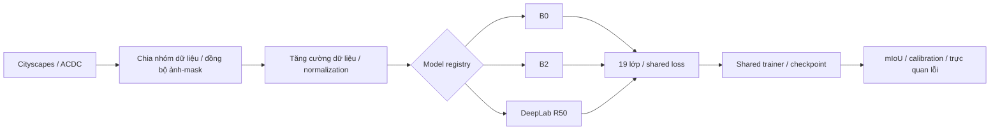

# Robust Semantic Segmentation under Adverse Weather

**Cityscapes → ACDC · B0 baseline · So sánh B2 và DeepLab · Chung quy trình huấn luyện**

[Chạy và khôi phục training](docs/TRAINING_GUIDE.md) · [Phương pháp](docs/RESEARCH_FRAMEWORK.md) · [Thuyết trình code](docs/PRESENT_TO_LECTURER.md) · [Bản thảo nghiên cứu](docs/paper/README.md) · [Chứng cứ kiểm thử](results/README.md)

## Tóm tắt

Project-CV nghiên cứu phân đoạn ảnh đường phố trong sương mù, ban đêm, mưa và tuyết. Mục tiêu là cải thiện các lớp dự đoán yếu trên ACDC, đồng thời hạn chế mất kiến thức đã học từ Cityscapes. Kiến trúc model được tách khỏi xử lý dữ liệu, loss, training và evaluation để kiểm tra từng giả thuyết trong cùng điều kiện.

Cả ba model bắt đầu từ encoder pretrained trên ImageNet và đầu phân đoạn mới. Bảng so sánh hiện hành không sử dụng checkpoint hay điểm số của các lần thử cũ. **B0 đã hoàn thành training**: ACDC dev nội bộ tăng từ 37.84% lên 51.65% mIoU; [báo cáo và giới hạn](results/segformer_b0_seed42/README.md). B2, DeepLab và kết quả official validation còn chờ thực hiện. Unit test và CPU probe chỉ xác nhận hoạt động của phần mềm.

## 1. Các model

| Model | Vai trò | Số tham số | GFLOPs được đếm¹ | File kiến trúc |
| --- | --- | ---: | ---: | --- |
| SegFormer-B0 | Baseline | 3,719,027 | 35.51 | [segformer_b0.py](src/models/segformer_b0.py) |
| SegFormer-B2 | Transformer chính | 27,361,235 | 258.33 | [segformer_b2.py](src/models/segformer_b2.py) |
| DeepLabV3+ ResNet50 | CNN đối chứng | 26,695,619 | 150.71 | [deeplabv3plus_resnet50.py](src/models/deeplabv3plus_resnet50.py) |

¹ Forward với batch 1, ảnh 512 × 1024; đếm các phép conv/matmul được PyTorch hỗ trợ, quy ước 2 FLOPs cho một phép nhân-cộng. DeepLab ít hơn B2 khoảng 2.43% tham số và 41.7% lượng tính toán được đếm. Đây là đối chứng gần về số tham số; tốc độ GPU và VRAM vẫn cần đo thực tế.

Kiến trúc dựa trên [SegFormer](https://arxiv.org/abs/2105.15203) và [DeepLabV3+](https://arxiv.org/abs/1802.02611). DeepLab trong repo dùng ASPP và decoder với separable convolution. Xem [ghi nhận nguồn](THIRD_PARTY_NOTICES.md).

## 2. Quy trình dùng chung



| Thành phần | Code |
| --- | --- |
| Dataset, chia dữ liệu, resize/crop/flip đồng bộ, ignore 255 | [dataset.py](src/data/dataset.py), [partitions.py](src/data/partitions.py) |
| Giữ tỷ lệ ảnh, khung 512 × 1024, ImageNet normalization | [shared_512.yaml](configs/preprocessing/shared_512.yaml) |
| CE, weighted CE theo tập fit, Focal, CE + Dice | [losses.py](src/training/losses.py) |
| Chọn model và ghép cấu hình thí nghiệm | [registry.py](src/models/registry.py), [config.py](src/experiments/config.py) |
| Optimizer, AMP, tích lũy gradient, best/last, resume | [train.py](src/training/train.py), [checkpoints.py](src/training/checkpoints.py) |
| Đánh giá ở kích thước gốc, ECE, bản đồ độ tin cậy và lỗi | [runner.py](src/evaluation/runner.py) |

Chạy đối chứng CE trước. Sau đó kiểm tra riêng ảnh hưởng của loss và class-aware crop; điểm IoU thấp không tự động đồng nghĩa với thiếu mẫu của lớp đó. [Công thức và ma trận thí nghiệm](docs/RESEARCH_FRAMEWORK.md).

## 3. Kaggle: ba lượt chạy riêng

| Lượt | Notebook | Hai giai đoạn |
| --- | --- | --- |
| 1 | [Train B0](notebooks/01_train_segformer_b0.ipynb) | Cityscapes 20 epoch → ACDC 20 epoch |
| 2 | [Train B2](notebooks/02_train_segformer_b2.ipynb) | Cityscapes 20 epoch → ACDC 20 epoch |
| 3 | [Train DeepLab](notebooks/03_train_deeplabv3plus_resnet50.ipynb) | Cityscapes 20 epoch → ACDC 20 epoch |

Mỗi notebook chạy một model và tự chuyển từ source sang adaptation, tổng cộng **40 epoch/model**. Một lượt có thể cần nhiều phiên Kaggle. Input cho lượt mới: **project-code.zip mới + Cityscapes + ACDC**, bật GPU và Internet. Notebook tự tìm dataset theo cấu trúc; có thể khai báo đường dẫn cụ thể nếu có nhiều bản trùng nhau. Chọn **Save Version → Save & Run All**. Xem [hướng dẫn đầy đủ](docs/TRAINING_GUIDE.md).

Checkpoint và ZIP kết quả cập nhật sau mỗi epoch hoàn thành. Các thế hệ checkpoint trước được giữ để khôi phục khi file mới hỏng. Resume dùng ZIP riêng của model và bản source đã đóng băng; epoch đang chạy dở sẽ được chạy lại. Cần lưu output trên Kaggle hoặc tải ZIP về giữa các phiên.

## 4. Cài đặt local và CLI

```bash
python -m venv .venv
# Windows: .venv/Scripts/Activate.ps1
# Linux: source .venv/bin/activate
python -m pip install -r requirements.txt
python -m pytest -q
python -m scripts.build_kaggle_notebooks
# Upload outputs/kaggle/project-code.zip cùng notebook của model cần chạy.
```

```bash
python -m scripts.prepare_research_data --city /datasets/Cityscape --acdc /datasets/ACDC --out outputs/data
python -m scripts.run_research_campaign --models segformer_b2 --data outputs/data/data.json --root outputs/runs/segformer_b2 --archive outputs/segformer_b2_seed42.zip
python -m scripts.verify_pipeline --data outputs/data/data.json --out outputs/cpu_probe
```

Đổi model được hỗ trợ bằng `--models`; dữ liệu, loss, trainer và evaluator được tái sử dụng. Các thí nghiệm ablation về sau dùng `scripts.run_research --model ... --stage adapt --loss focal ...` cùng checkpoint source mới của chính model đó.

Chạy demo sau khi có checkpoint:

```bash
python -m pip install -r requirements-demo.txt
python -m streamlit run app.py
```

Chọn model và thư mục checkpoint `best/` tương ứng trong giao diện.

## 5. Thiết lập thí nghiệm

| Thiết lập | Source | Adaptation có nhãn |
| --- | --- | --- |
| Dữ liệu train | Cityscapes: 2,787 ảnh fit | ACDC: 1,198 ảnh fit + source replay tỷ lệ 1:1 |
| Chọn checkpoint | Cityscapes: 188 ảnh monitor | ACDC: 402 ảnh dev; mức giảm source ≤ 1 điểm phần trăm |
| Số epoch / early stopping | 20 / tắt | 20 / tắt |
| Batch / tích lũy gradient | 2 / 4; `drop_last` | 1 / 8 |
| BatchNorm: thống kê / affine | Cập nhật / học | Đóng băng / học |
| AdamW: LR encoder / hệ số LR head | 6e-5 / 10 | 1e-5 / 1 |
| Weight decay / warm-up / poly power | 0.01 / 20 bước cập nhật / 1 | Tương tự |
| GPU / precision | Một GPU / FP16 AMP | Tương tự |

Nhánh pooled BatchNorm của DeepLab cần batch source thực tế ≥ 2; tích lũy gradient không gộp thống kê BatchNorm. Encoder SegFormer dùng LayerNorm. Cityscapes val 500 và ACDC val 406 chỉ được đánh giá sau khi chốt checkpoint. Do các tập này từng được xem trong giai đoạn phát triển trước, chúng chưa phải bằng chứng test độc lập. Kết quả UDA và supervised có quyền truy cập nhãn khác nhau, cần trình bày riêng khi đối chiếu bài báo.

## 6. Bản đồ repository

```text
src/data/          # Dataset, chia dữ liệu, augmentation, trọng số lớp, replay
src/models/        # File riêng cho B0, B2, DeepLab; registry và loader
src/training/      # Loss, optimizer, BatchNorm, trainer và checkpoint dùng chung
src/evaluation/    # Metrics, calibration, trực quan kết quả
src/experiments/   # Ghép cấu hình và đóng gói workspace
scripts/           # Chuẩn bị → train/resume → vẽ biểu đồ → đánh giá → đóng gói
configs/           # Preprocessing, recipe theo giai đoạn, loss preset
notebooks/         # Ba notebook hiện hành, mỗi model một notebook
research/          # Kế hoạch thí nghiệm và ghi chú bài báo
results/           # Chứng cứ kiểm thử gọn nhẹ; chờ kết quả GPU mới
outputs/           # Checkpoint, ZIP, CPU probe, archive local; Git bỏ qua
```

[Hướng dẫn thành viên](docs/CONTRIBUTING.md) · [Mục lục tài liệu](docs/README.md) · [Trích dẫn phần mềm](CITATION.cff).
