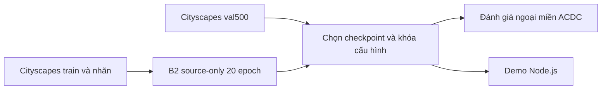

[Kế hoạch hoàn thành B2 + DeepLab với 30 giờ GPU](research/PROJECT_COMPLETION_PLAN.md)


# Project-CV · Phân đoạn đường phố bền vững theo DG

**B2 chính · Chỉ học Cityscapes · ACDC chỉ đánh giá sau khi khóa model · Node.js demo**

[Protocol khôi phục DG](research/DG_RECOVERY_PLAN.md) · [Train/resume](docs/TRAINING_GUIDE.md) · [Đọc code](docs/READING_GUIDE.md) · [Kết quả và lịch sử](results/README.md)

## Bài toán

Cho một ảnh đường phố, dự đoán 19 lớp cho từng pixel: đường, người, xe, cây, bầu trời… Model phải xử lý được đêm, sương mù, mưa và tuyết dù **không dùng ảnh/nhãn ACDC để học hoặc chọn checkpoint**. Đây là Domain Generalization (DG), đúng ranh giới dữ liệu trong kế hoạch Word ban đầu. B2 thay B0 theo quyết định đổi backbone sau này; đây là thay đổi cần ghi rõ.

## Sửa hướng triển khai

Nhánh trước đây đã học ảnh và nhãn ACDC nên thuộc supervised adaptation, không đáp ứng mục tiêu DG. Kết quả ACDC dev **63,02% của B2 adapted không phải kết quả DG**. Weights/báo cáo được giữ nguyên làm lịch sử; không đổi tên để sử dụng như DG.

Checkpoint B2 source cũ chỉ học Cityscapes và còn dùng làm tham khảo được, nhưng split fit2787/monitor188 khác kế hoạch gốc. Baseline DG mới dùng **Cityscapes train2975 → chọn best bằng Cityscapes val500**, 20 epoch, encoder ImageNet + head mới. **Chưa có kết quả GPU cho baseline mới.** [Phương pháp đã cài và kiểm thử](docs/DG_METHOD.md).



ACDC không đi vào trainer, augmentation, pseudo-label hay chọn best. Đã triển khai ba arm baseline/aug/consistency dùng chung cho B2 và DeepLab; xem [ma trận baseline/augmentation/consistency và nguồn paper](research/DG_RECOVERY_PLAN.md). **Đã qua CPU QA; chưa có full GPU run hoặc bằng chứng tăng mIoU.**

## Chạy DG baseline khi có GPU

```powershell
.venv/Scripts/python.exe -m scripts.build_kaggle_notebooks
```

Import [01_dg_segformer_b2.ipynb](notebooks/01_dg_segformer_b2.ipynb). Input chỉ cần **code ZIP DG mới + Cityscapes train/val**; không gắn ACDC cho lượt train. Code ZIP ở `outputs/kaggle/project-code.zip`. Notebook B2 và [DeepLab](notebooks/02_dg_deeplabv3plus_resnet50.ipynb) đều tự chạy **profiling → baseline20 → aug20 → consistency20**. Không cần đổi ARM/PROFILE_ONLY. Dữ liệu chuẩn bị một lần mỗi model, một ZIP chung cập nhật sau mỗi epoch; resume tự tiếp tục phần chưa xong. [Hướng dẫn đầy đủ](docs/TRAINING_GUIDE.md).

Launcher/campaign supervised cũ đã bị chặn mặc định và cần opt-in rõ ràng `--allow-supervised-acdc` cho công việc lịch sử. Hai notebook source→adapt cũ nằm ở [research/archive/notebooks](research/archive/notebooks), không còn là notebook hiện hành.

## Đọc repo theo luồng

| Thành phần | Vai trò / file mở đầu |
| --- | --- |
| `src/data/` | [Nhãn](src/data/labels.py), [dataset](src/data/dataset.py), [xử lý](src/data/preprocessing.py) dùng lại; replay/target partitions là lịch sử supervised |
| `src/models/` | [B2 riêng](src/models/segformer_b2.py), [registry](src/models/registry.py); DeepLab tùy chọn, B0 legacy |
| `src/experiments/` | [DG guard](src/experiments/protocol.py) chặn target; [config](src/experiments/config.py) ghép recipe |
| `src/training/` | [Trainer](src/training/train.py), CE/optimizer/checkpoint dùng chung |
| `scripts/` | [run_dg.py](scripts/run_dg.py) chuẩn bị Cityscapes và train/resume; [script map](scripts/README.md) |
| `src/evaluation/` | [Native evaluator](src/evaluation/runner.py), per-class/weather mIoU và lỗi |
| `notebooks/` | [Notebook DG hiện hành](notebooks/README.md) |
| `web/` | [Node.js UI + Python inference](web/README.md); demo hiện chứa checkpoint lịch sử, không là bằng chứng DG mới |
| `research/` | [Kế hoạch DG](research/DG_RECOVERY_PLAN.md), paper reviews, archive |
| `results/` | [Bằng chứng và kết quả lịch sử](results/README.md); chưa có DG benchmark mới |
| `data/`, `outputs/` | Dữ liệu/weights/ZIP local, không đẩy Git |

[Lộ trình đọc chi tiết](docs/READING_GUIDE.md) · [Thuyết trình](docs/PRESENT_TO_LECTURER.md) · [Nguồn/giấy phép](THIRD_PARTY_NOTICES.md)

## Demo local và giới hạn

Cài Python dependencies từ `requirements.txt`, có checkpoint local, dùng Node.js22+ rồi `npm start`. Mở [WeatherLens](http://127.0.0.1:3000). [Hướng dẫn weights](web/README.md). UI phải ghi rõ source-only hay supervised lịch sử; chất lượng ảnh upload không được suy ra từ điểm dev cũ.

ACDC từng được xem trong phát triển; protocol mới chặn target training/selection nhưng không làm ACDC val trở lại test độc lập. Cần công bố giới hạn này. Không so trực tiếp điểm DG với UDA/supervised có quyền dùng target khác nhau, hoặc khẳng định vượt paper bằng điểm khác split/recipe.
