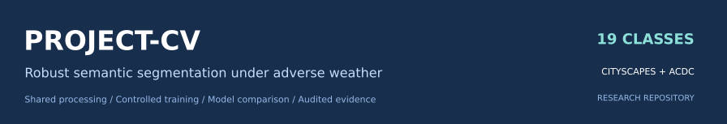

# Project-CV · Phân đoạn đường phố trong thời tiết xấu



**Học từ Cityscapes → kiểm tra trên ACDC. Hai model: SegFormer-B2 và DeepLabV3+ ResNet50.**

Ảnh đầu vào là một cảnh đường phố. Đầu ra là bản đồ 19 lớp cho từng pixel: đường, vỉa hè, người, xe, cây… Mục tiêu là giữ chất lượng khi gặp đêm, sương mù, mưa và tuyết, dù model chỉ học ảnh Cityscapes.

Cách làm này gọi là **Domain Generalization (DG)**: học ở điều kiện nguồn, kiểm tra ở điều kiện khác. ACDC không được dùng để train, lấy style hoặc chọn model trong luồng hiện hành.

**Nhánh thử nghiệm K1 + K2:** [notebook04](notebooks/04_k2_weatherseg_b0_train.ipynb) train WeatherSeg-B0 với FiLM và condition head từ ảnh K1, có ZIP/resume. [Hướng dẫn](docs/K2_TRAINING.md). Đây là thí nghiệm riêng; chưa có kết quả full GPU và không thay thế cohort B2/DeepLab dưới đây.

## Project hiện làm được gì?

| Thành phần | Hiện trạng |
| --- | --- |
| Hai model có file code riêng | B2 và DeepLab đã có forward, backward, nạp/lưu weights; dùng chung pipeline |
| Đọc dữ liệu và xử lý ảnh–mask | Tạo danh sách cặp ảnh/nhãn, kiểm tra dữ liệu, chuyển nhãn, biến đổi hình học đồng bộ |
| Ba chiến thuật cho **mỗi model** | `baseline`, `aug`, `consistency`; đã có code và kiểm thử CPU |
| Train trên Kaggle | Hai notebook tự chuẩn bị dữ liệu → đo GPU → chạy ba chiến thuật, mỗi chiến thuật 20 epoch |
| Checkpoint và tiếp tục train | Lưu best/last, trạng thái optimizer và RNG; xuất ZIP sau mỗi epoch hoàn thành |
| Đánh giá và trực quan hóa | mIoU từng lớp/thời tiết, learning curves, ảnh nhãn/dự đoán/lỗi và độ tự tin |
| Demo Node.js | Upload ảnh, xem mask/overlay, tải kết quả; hiện dùng checkpoint B2 **lịch sử** trên CPU |
| Kết quả DG mới | **Chưa có đủ sáu lượt train GPU; chưa chứng minh phương pháp cải thiện mIoU** |

Code đã qua kiểm thử phần mềm và chạy thử CPU với ít ảnh thật. Điều đó xác nhận pipeline hoạt động ở phạm vi đã thử, chưa xác nhận hội tụ hay chất lượng trên GPU. [Bằng chứng và kết quả](results/README.md).

## Dữ liệu được dùng thế nào?

| Tập dữ liệu | Số ảnh | Vai trò hiện hành |
| --- | ---: | --- |
| Cityscapes train | 2.975 | Học model, tạo các phiên bản ảnh tăng cường |
| Cityscapes val | 500 | Theo dõi và chọn checkpoint tốt nhất |
| ACDC val | 406 | Chỉ đánh giá sau khi chốt cấu hình và checkpoint của sáu lượt |

**Không dùng ACDC train trong luồng DG.** Các thử nghiệm cũ từng học cả ảnh/nhãn ACDC thuộc hướng khác; giữ để truy vết và phục vụ demo, không đưa điểm đó vào bảng DG. ACDC cũng đã được xem trong quá trình phát triển trước đây, nên cần công bố giới hạn này khi báo cáo.

## Ba chiến thuật được so sánh

| Tên trong code | Hiểu đơn giản | Mục đích |
| --- | --- | --- |
| `baseline` | Học ảnh nguồn với loss CE thông thường | Mốc so sánh của từng model |
| `aug` | Thêm ảnh đổi độ sáng/màu, nhiễu và mờ; giữ cùng nội dung/nhãn | Kiểm tra lợi ích tăng đa dạng ảnh nguồn |
| `consistency` | Như `aug`, thêm yêu cầu hai phiên bản ảnh dự đoán nhất quán | Kiểm tra riêng lợi ích của ràng buộc nhất quán |

CE là mức phạt khi model đoán sai lớp của pixel. Một epoch là một lượt học qua tập train. Checkpoint là bản lưu để dùng lại hoặc tiếp tục train. mIoU đo mức khớp giữa vùng dự đoán và nhãn thật, trung bình các lớp; càng cao càng tốt.

Cả B2 và DeepLab đều chạy đủ ba chiến thuật, **khởi tạo độc lập**, cùng seed và cùng recipe. Không học nối từ baseline sang aug/consistency. Tổng cộng sáu lượt × 20 epoch. [Thông số và công thức](docs/DG_METHOD.md).

## Thành viên mới bắt đầu từ đâu?

1. Đọc trang này để nắm bài toán, phạm vi dữ liệu và trạng thái thật.
2. Đọc [luồng code](docs/READING_GUIDE.md), rồi [quy ước dữ liệu](docs/DATA_CONTRACT.md).
3. Đọc [phương pháp DG](docs/DG_METHOD.md) để hiểu cách train và các phép so sánh.
4. Làm theo [hướng dẫn Kaggle/resume](docs/TRAINING_GUIDE.md) hoặc [chạy demo](web/README.md).
5. Trước khi sửa code, đọc [hướng dẫn đóng góp](docs/CONTRIBUTING.md). Việc còn lại ở [kế hoạch hoàn thành](research/PROJECT_COMPLETION_PLAN.md).

## Cấu trúc repo

```text
configs/         Recipe 20 epoch, preprocessing và augmentation dùng chung
src/data/        Dataset, nhãn, xử lý ảnh và tăng cường dữ liệu
src/models/      File B2, file DeepLab, registry chọn/nạp model
src/training/    Trainer, loss, optimizer, DG và checkpoint dùng chung
src/experiments/ Ghép config, chặn dùng sai dữ liệu, khóa kết quả
src/evaluation/  Metrics và xuất ảnh đánh giá
scripts/         Lệnh chuẩn bị, chạy suite, đánh giá và tạo notebook
notebooks/       Hai notebook hiện hành: một B2, một DeepLab
web/             Node.js API/giao diện + Python inference
tests/           Kiểm thử pipeline, checkpoint và protocol
docs/            Hướng dẫn đọc/chạy/sửa code
research/        Cơ sở bài báo và kế hoạch thực nghiệm
results/         Báo cáo nhỏ, bằng chứng kiểm tra và kết quả lịch sử
data/, outputs/  Dataset, weights và ZIP local; không đẩy lên Git
```

B0 thuần trong `src/models/legacy/` phục vụ checkpoint cũ và control của thí nghiệm K1/K2; không nằm trong cohort sáu lượt B2/DeepLab. WeatherSeg-B0 ở `src/models/proposed/`. Các tiện ích replay/chia tập/loss khác còn giữ cho tương thích và kiểm thử; **không được bật trong recipe DG hiện hành**.

## Chuẩn bị và chạy

Python 3.11+, PyTorch từ 2.6 và TorchVision tương thích. Chọn bản PyTorch phù hợp môi trường CPU/CUDA trước khi cài dependencies. Node.js 22+ cần cho demo.

```powershell
python -m venv .venv
.venv/Scripts/python.exe -m pip install -r requirements.txt
.venv/Scripts/python.exe -m scripts.build_kaggle_notebooks
```

Lệnh cuối tạo `outputs/kaggle/project-code.zip` và cập nhật hai notebook:

- [01_dg_segformer_b2.ipynb](notebooks/01_dg_segformer_b2.ipynb)
- [02_dg_deeplabv3plus_resnet50.ipynb](notebooks/02_dg_deeplabv3plus_resnet50.ipynb)

Trên Kaggle, thêm **code ZIP mới + Cityscapes train/val**, chọn GPU và chạy notebook của model cần train. Mỗi notebook tự chạy cả ba chiến thuật. `None` ở đường dẫn dataset nghĩa là tự tìm; `RESUME_INPUT=None` nghĩa là lượt mới. [Cách đặt đường dẫn, giữ ZIP và resume](docs/TRAINING_GUIDE.md).

Demo local: `npm start`, mở [localhost:3000](http://127.0.0.1:3000). Cần nạp checkpoint theo [web/README.md](web/README.md); clone source đơn thuần chưa có weights. Demo hiện chưa tích hợp weights DG mới hoặc DeepLab đã train.

```powershell
.venv/Scripts/python.exe -m pytest -q
npm test
```

## Còn phải hoàn thành

Chạy và nghiệm thu sáu lượt GPU; khóa các checkpoint; đánh giá ACDC cùng cách tính; tổng hợp per-class/per-weather và chi phí; tích hợp weights DG vào demo; hoàn thiện báo cáo/video. Hai notebook có thể tiếp tục qua nhiều phiên. **Chưa bảo đảm sáu lượt vừa 30 giờ GPU**; cần timing thật trước khi chốt lịch.

[Cơ sở bài báo](research/README.md) · [Giấy phép và nguồn code](THIRD_PARTY_NOTICES.md) · [Kết quả hiện có](results/README.md)
