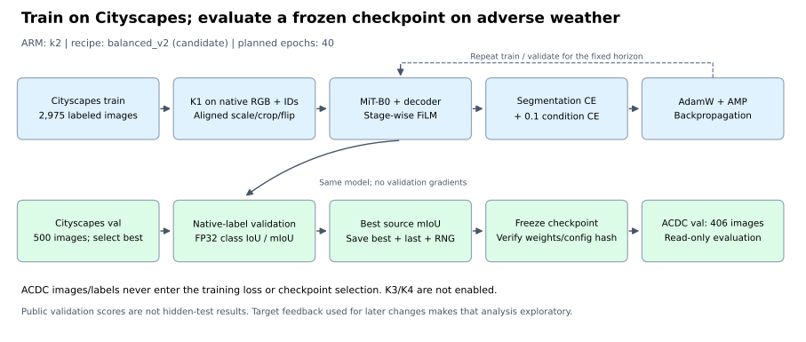
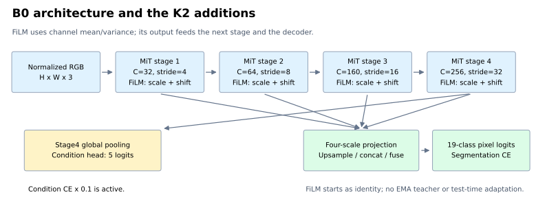

# K2: recipe ứng viên, đánh giá sau train và biểu đồ

Nhánh riêng `feat/k1-weather-augmentation`. K3/K4 chưa bật. Hai notebook mới:





| Notebook | Công việc |
| --- | --- |
| [05_k2_balanced_train_eval.ipynb](../notebooks/05_k2_balanced_train_eval.ipynb) | Một lượt train với recipe mới, khóa checkpoint rồi đánh giá và vẽ hình |
| [06_k2_evaluate_report.ipynb](../notebooks/06_k2_evaluate_report.ipynb) | Chỉ đánh giá ZIP checkpoint đã train xong; không train lại |

## Vì sao chưa đạt80%?

Điểm đang nói là **mIoU**, không phải tỷ lệ pixel đúng. B0 nhỏ không mặc định phải vượt80%: bài SegFormer báo76,2% Cityscapes cho B0; B5 mới có điểm84,0% trong thiết lập của tác giả. Các điểm trên ACDC còn phụ thuộc quyền dùng dữ liệu đích, backbone và cách inference; không dùng bảng supervised để đặt ngưỡng phải đạt cho DG B0.

Code gốc của tác giả dùng recipe160k iterations, warmup1500 và crop1024×1024. Run hiện tại của project dùng20epoch, canvas512×1024, warmup20, nên không phải tái lập recipe/điểm paper. Nguồn: [paper](https://papers.neurips.cc/paper/2021/file/64f1f27bf1b4ec22924fd0acb550c235-Paper.pdf), [config chính thức](https://github.com/NVlabs/SegFormer/blob/master/local_configs/segformer/B0/segformer.b0.1024x1024.city.160k.py).

Baseline đã đọc trên Kaggle đạt64,73% Cityscapes val500; K1+K2 pilot đạt60,68%. Đây là tín hiệu cần kiểm tra augmentation, FiLM và auxiliary loss bằng đối chứng; chưa chứng minh lỗi nằm riêng ở FiLM hoặc độ chính xác trên thời tiết thật kém hơn.

## Hai recipe phải tách riêng

| Thông số | `legacy_v1` | `balanced_v2` ứng viên |
| --- | --- | --- |
| Notebook | 04, giữ nguyên đối chứng cũ | 05 |
| Epoch mặc định | 20 | 40 |
| Canvas | 512×1024 | 640×1280 |
| Warmup optimizer updates | 20 | 500 |
| DataLoader workers | 2 | 4 |
| Crop theo lớp nguồn | Tắt | Xác suất0,5; ưu tiên lớp ít pixel hiện diện |
| K1 clean probability | 0,25 khi không fog | 0,5; phần còn lại chia đều điều kiện xấu |
| K1 severity | 1–5 | 1–3 |

Đây là **recipe để thử**, chưa có kết quả GPU chứng minh tăng mIoU. LR6e-5, head×10, AdamW, CE, batch2/accumulation4 và kiến trúc B0 giữ nguyên. Crop chỉ đọc nhãn Cityscapes train; không dùng thống kê hoặc nhãn ACDC để tối ưu. Cả năm arm baseline/film_clean/aug/film/k2 đều nhận cùng recipe nguồn mới.

Không so K2 recipe40epoch mới với baseline20epoch cũ rồi quy mức tăng cho K2. Công cụ `scripts.k2_results compare` chặn trộn recipe, seed, geometry hoặc initialization không khớp. Không sửa ZIP20epoch để resume lên40epoch; phải mở run mới với lịch40epoch ngay từ đầu. Run40epoch có thể cần nhiều phiên Kaggle, nhất là khi có K1/depth. Chưa có bảo đảm vừa quota hoặc vượt80%.

## Cách chạy trên Kaggle

### Đánh giá các checkpoint đang có trước

1. Import notebook06. Gắn ZIP kết quả đã hoàn thành (full hoặc share có đủ metadata), Cityscapes và ACDC; bật GPU + Internet.
2. Nếu chỉ gắn một result, `RESULT_INPUT=None` sẽ tự tìm. Nếu có nhiều result, đặt đường dẫn ZIP/thư mục cụ thể. Giữ `CODE_INPUT=None` để clone đúng nhánh riêng.
3. Run All / Save & Run All. Notebook kiểm tra run đã đủ horizon, best/checkpoint/config/manifest hashes và source inference trước khi đọc dữ liệu đích.
4. Kết quả ở `k2_post_training_evaluation.zip`: Cityscapes val500, ACDC val406 theo sương/đêm/mưa/tuyết, từng lớp, calibration, confusion và panel RGB/GT/prediction/confidence/error.
5. Muốn so baseline và K2: đánh giá từng checkpoint bằng cùng geometry/precision, giữ cả hai ZIP. Không chọn lại epoch dựa trên điểm ACDC.

Nếu result share cũ thiếu `run/best/checkpoint.json` hoặc provenance, dùng ZIP đầy đủ; không bỏ qua kiểm tra để chạy cho được.

Kaggle có thể tự giải nén cả `source.zip` bên trong result thành thư mục `source/`. Bộ đánh giá hỗ trợ cả hai dạng và vẫn kiểm tra hash từng file inference với plan đã khóa trước khi đọc dữ liệu đánh giá. Không cần tải lại checkpoint chỉ vì archive bên trong đã được giải nén.

### Train recipe mới

1. Import notebook05. Gắn Cityscapes và ACDC; ACDC chỉ được đọc sau khi train đủ40epoch và khóa checkpoint.
2. Mặc định `ARM='baseline'`, `EPOCHS=40`, `WEATHER_MODE='no-fog'`, `EVAL_AFTER_TRAIN=True`. Sau đó chạy các arm còn lại trong phiên độc lập cùng recipe/seed. Có depth đúng đơn vị mới bật `full` cho cả nhóm weather.
3. Notebook train, lưu full/share ZIP từng epoch. Chưa đủ horizon thì vẽ đường học nguồn và báo cần resume, không evaluate ACDC.
4. Khi đủ40epoch, tự đánh giá checkpoint best rồi hiển thị biểu đồ/panel. Nếu thiếu ACDC hoặc evaluation lỗi, ZIP train vẫn được giữ; sửa input và dùng notebook06 để chỉ đánh giá.
5. Output gồm ZIP đầy đủ để resume, ZIP nhẹ để gửi model + hình, và ZIP evaluation. `RESUME_INPUT` phải là ZIP đầy đủ của đúng recipe/ARM/seed/horizon; source cũ được phục hồi nguyên trạng.

ACDC có thể tách `rgb_anon` và `gt` thành hai mount; đặt `ACDC_ROOT` và `ACDC_MASK_ROOT` nếu auto-find không có đúng một ứng viên. Cấu trúc chuẩn: `rgb_anon/<condition>/val/<recording>/*_rgb_anon.png` và `gt/<condition>/val/<recording>/*_gt_labelTrainIds.png`. Đánh giá yêu cầu fog100/night106/rain100/snow100; không tự lấy train hoặc subset thay vào.

## Validation và test chính thức

ACDC có406ảnh validation với nhãn công khai; test2000ảnh giấu nhãn và chấm trên evaluation server. Luồng mới tự tính điểm **validation**, không tự nhận là test score, không nộp kết quả lên server và không cập nhật weights theo target. [ACDC benchmark](https://acdc.vision.ee.ethz.ch/benchmarks), [paper dataset](https://acdc.vision.ee.ethz.ch/other/ACDC_the_Adverse_Conditions_Dataset_with_Correspondences_for_semantic_driving_scene_understanding-Sakaridis%2BDai%2BVan_Gool-ICCV_21.pdf).

Theo yêu cầu đánh giá ngay sau mỗi run, kết quả được ghi là **exploratory post-training validation**. ACDC đã có feedback lịch sử; nếu tiếp tục dùng điểm ACDC để sửa phương pháp thì không gọi đợt sau là test độc lập mới. Điều này khác với luồng main B2/DeepLab vẫn yêu cầu khóa cohort sáu candidate trước khi evaluate.

## Những hình tự xuất

| Hình | Ý nghĩa |
| --- | --- |
| `training_pipeline.png/.svg` | Luồng Cityscapes → K1/B0/FiLM → CE/AdamW → Cityscapes selection → checkpoint khóa → ACDC |
| `k2_architecture.png/.svg` | Bốn stage MiT-B0, FiLM, decoder nhiều tỷ lệ và nhánh điều kiện |
| `learning_curves.png/.svg` | Objective train, Cityscapes val mIoU, val CE và learning rate ở các trục riêng |
| `class_learning.png/.svg` | Heatmap IoU19lớp qua từng epoch |
| `best_class_iou.png/.svg` | IoU19lớp tại checkpoint được chọn |
| `condition_learning.png/.svg` | CE/accuracy nhận phép biến đổi K1, chỉ khi nhánh điều kiện được học |
| `weather_miou.png/.svg` | Điểm Cityscapes và từng thời tiết ACDC sau đánh giá |
| `*_confusion.png/.svg` | Confusion matrix chuẩn hóa theo lớp thật |
| `panels/<condition>.png` | Ảnh đầu tiên mỗi điều kiện theo thứ tự manifest cố định, không chọn ảnh đẹp |

PNG dùng xem nhanh, SVG dùng đưa vào báo cáo/slide. Accuracy condition không phải độ chính xác phân đoạn. `evaluation_seconds` gồm I/O, metrics và vẽ panel, không được đổi trực tiếp thành FPS model.

## CLI tương ứng

```powershell
python -m scripts.run_k2 --city <city-root> --root outputs/k2_v2_baseline --archive outputs/k2_v2_baseline.zip --arm baseline --recipe balanced_v2 --epochs 40 --weather-mode no-fog
python -m scripts.evaluate_k2 --input <completed-result.zip> --city <city-root> --acdc <acdc-root> --out outputs/k2_evaluation --device cuda
python -m scripts.plot_k2 --input <completed-result.zip> --evaluation outputs/k2_evaluation --out outputs/k2_figures
```

Local CPU QA dùng checkpoint random và ảnh nguồn/đích giả lập nhỏ để kiểm seal, geometry, metrics, weights không đổi và tạo hình; không phải kết quả độ chính xác trên ACDC. Máy local hiện không có dữ liệu ACDC đầy đủ hoặc CUDA, nên đánh giá406ảnh thật và đo cải thiện recipe mới cần chạy Kaggle.
