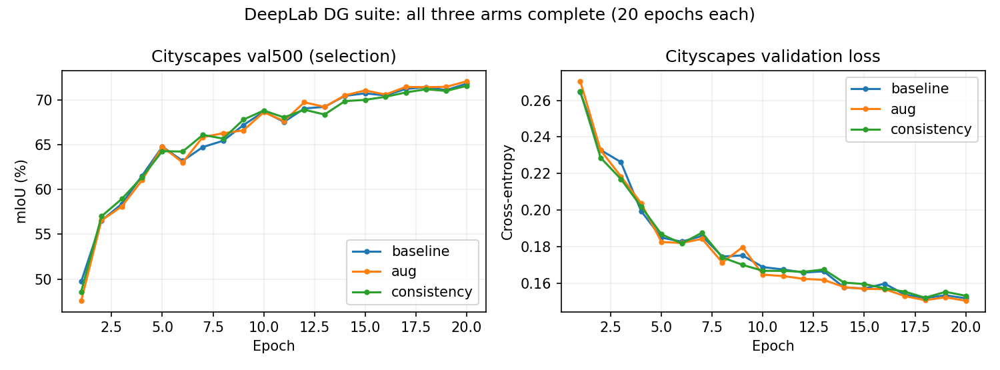

# DeepLabV3+ ResNet50 DG · seed42 · đủ ba nhánh

**Cập nhật 26/11/2026:** đã đánh giá đủ sáu checkpoint trên Cityscapes val500 và ACDC val406. [Kết quả đã nghiệm thu](../dg_evaluation_seed42/README.md). Các bước/chứng cứ bên dưới ghi lại thời điểm trước đánh giá.

Nghiệm thu ngày 24/11/2026 từ `dg_deeplabv3plus_resnet50_suite_seed42 (1).zip`. Cả ba nhánh hoàn thành 20 epoch. [Bằng chứng kiểm tra](verification.json) · [Đường học CSV](learning_curves.csv) · [IoU từng lớp](per_class_best.csv).

| Nhánh | Epoch hoàn thành | Best epoch | Cityscapes val500 mIoU |
| --- | ---: | ---: | ---: |
| baseline | 20/20 | 20 | 71,82% |
| aug | 20/20 | 20 | 72,08% |
| consistency | 20/20 | 20 | 71,58% |

Aug hơn baseline **0,263 điểm phần trăm**. Consistency thấp hơn aug **0,507 điểm** và thấp hơn baseline **0,244 điểm**. Đây là kết quả trên tập nguồn dùng chọn checkpoint; chưa chứng minh tăng hay giảm chất lượng thời tiết xấu. Một seed chưa cho phép kết luận ổn định thống kê.

Cả ba nhánh có best ở epoch 20; validation loss nhìn chung giảm. Chưa thấy xu hướng suy giảm kéo dài trên tập nguồn trong 20 epoch, nhưng đường học này không chứng minh model không overfit hoặc sẽ tốt trên ACDC. Giữ giới hạn 20 epoch đã chốt để hoàn thành phép so sánh, không kéo dài riêng nhánh có điểm thấp.

## Kiểm tra ZIP và lượt resume

- Đọc CRC toàn bộ 3.590 mục; kiểm 36 hash file checkpoint, 272 hash source trong bốn snapshot, config/plan/profile và best đã khóa.
- Log mỗi nhánh đủ epoch 1–20; best/last khớp log. Mỗi nhánh có 7.438 bước cập nhật; cùng khởi tạo và đúng nguồn Cityscapes train2975/val500.
- Đối chiếu checkpoint epoch 4 đã bàn giao: 56 file run baseline/aug giữ nguyên, ngoại trừ metadata recovery; log và resources consistency của bốn epoch đầu giữ nguyên. Lượt mới tiếp tục đúng thí nghiệm cũ.
- Aug/consistency có cùng lịch paired minibatch; KL hữu hạn, λ=0,1. Source hiện tại khớp source đã khóa; không chạy code nhúng hoặc nạp pickle training state khi audit.
- Ba candidate qua bộ kiểm tra của evaluator; ba best checkpoint qua nạp strict và CPU smoke. Đây là kiểm tra phần mềm, không phải inference đánh giá chất lượng.

Lượt resume mất khoảng **4,62 giờ**, gồm overhead trước lần xuất cuối. Tổng train+validation của consistency qua cả hai lượt khoảng **4,28 giờ**. Tổng train+validation ba nhánh DeepLab khoảng **11,22 giờ**; không bao gồm toàn bộ setup/ZIP/checkpoint.

## Đối chiếu với B2

| Cùng Cityscapes val500, 20 epoch | B2 | DeepLab | B2 − DeepLab |
| --- | ---: | ---: | ---: |
| baseline | 73,98% | 71,82% | +2,16 điểm |
| aug | 74,37% | 72,08% | +2,29 điểm |
| consistency | 74,44% | 71,58% | +2,86 điểm |

Source, danh sách dữ liệu, 3.475 mask sau chuyển nhãn và recipe của các nhánh tương ứng khớp. Khác kiến trúc và encoder ImageNet; không quy chênh lệch chỉ cho số tham số. Consistency hơn aug rất ít ở B2 nhưng giảm ở DeepLab trên nguồn; chưa có bằng chứng nó cải thiện DG.

## Bước tiếp theo

**Đã đủ sáu candidate; không cần resume training.** [Biên bản khóa cohort](../dg_cohort_seed42/README.md) lưu danh tính và hash cả sáu best checkpoint trước đánh giá target. Dùng các checkpoint này để đánh giá Cityscapes val500 và ACDC val406 với cùng FP32, output native, không TTA; báo từng lớp và từng thời tiết.

Không học ACDC, không dùng điểm ACDC để đổi best hoặc tune lại sáu candidate. ACDC đã từng được xem trong phát triển lịch sử; phải công bố giới hạn đó. [Hướng dẫn đánh giá](../../docs/TRAINING_GUIDE.md#freeze-và-evaluate-sau-cả-hai-suite).

Release epoch4 và notebook03 giữ làm lịch sử bàn giao, không phải checkpoint hoàn chỉnh để đánh giá cuối. ZIP mới `(1)` mới là artifact DeepLab hoàn chỉnh.
