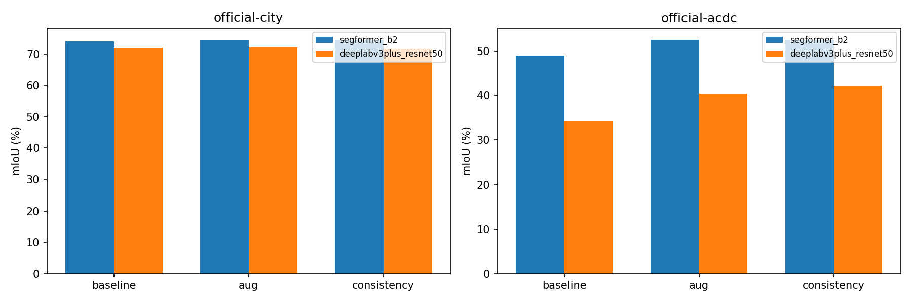

# Đánh giá DG · Cityscapes val500 + ACDC val406

Nghiệm thu ngày 26/11/2026 từ `dg_evaluation_seed42.zip`. Đủ **12 phép đánh giá, sáu best checkpoint đã khóa**, không train hoặc chọn lại best trên ACDC. [Biên bản kiểm tra](verification.json) · [Bảng tổng](summary.csv) · [Từng thời tiết](per_weather.csv) · [Từng lớp](per_class.csv) · [Chênh lệch phương pháp](strategy_deltas.csv).

| Model | Chiến thuật | Cityscapes val500 | ACDC val406 |
| --- | --- | ---: | ---: |
| SegFormer-B2 | baseline | 73,98% | 49,02% |
| SegFormer-B2 | aug | 74,37% | 52,47% |
| SegFormer-B2 | consistency | 74,44% | 52,46% |
| DeepLabV3+ ResNet50 | baseline | 71,82% | 34,26% |
| DeepLabV3+ ResNet50 | aug | 72,08% | 40,35% |
| DeepLabV3+ ResNet50 | consistency | 71,58% | 42,20% |

Điểm là mIoU gộp confusion matrix toàn tập rồi lấy trung bình các lớp có union khác 0. Không lấy trung bình mIoU từng ảnh hoặc bốn thời tiết. Cùng FP32, canvas512×1024 giữ tỷ lệ, trả logits về kích thước nhãn gốc, ignore255, không TTA và không target BN. Điểm Cityscapes ở đây là native evaluation; chênh rất nhỏ so với monitor khi train.

## Kết quả của các chiến thuật

- **Augmentation cải thiện trên cả hai model trong seed này:** B2 tăng **3,456 điểm phần trăm** trên ACDC, DeepLab tăng **6,094 điểm** so với baseline. Cả hai cùng cải thiện mIoU từng thời tiết.
- **Consistency phụ thuộc kiến trúc:** B2 giảm **0,013 điểm** so với aug, chưa có lợi ích mIoU gộp; DeepLab tăng **1,848 điểm**. Không kết luận consistency luôn tốt hơn hoặc khác biệt có ý nghĩa thống kê từ một seed.
- B2 có điểm ACDC cao hơn DeepLab ở cả ba nhánh. B2 aug cao nhất trong sáu candidate với 52,47%; kết quả target này không được dùng để sửa/chọn lại checkpoint trong cohort đã khóa.
- DeepLab consistency giảm điểm nguồn so với aug nhưng tăng điểm target. Do đó điểm Cityscapes đơn lẻ không quyết định khả năng tổng quát sang thời tiết xấu.

## Từng thời tiết

| Model / nhánh | Sương mù100 | Đêm106 | Mưa100 | Tuyết100 |
| --- | ---: | ---: | ---: | ---: |
| B2 baseline | 66,23% | 26,45% | 53,16% | 49,41% |
| B2 aug | 68,06% | 28,75% | 54,60% | 54,85% |
| B2 consistency | 68,29% | 28,74% | 54,39% | 54,71% |
| DeepLab baseline | 54,95% | 15,80% | 40,50% | 40,13% |
| DeepLab aug | 57,28% | 22,33% | 43,76% | 44,57% |
| DeepLab consistency | 57,01% | 23,47% | 43,08% | 45,61% |

**Ban đêm vẫn là điểm yếu rõ nhất.** Với B2 aug, rider16,03%, bicycle25,54%, motorcycle27,12%, wall29,11%, fence33,85% là năm lớp thấp nhất trên ACDC gộp. Đây là mô tả lỗi; chưa chứng minh nguyên nhân là thiếu dữ liệu, loss hoặc augmentation. Cần xem panel dự đoán/lỗi trong ZIP trước khi chọn hướng phát triển.

## Kiểm chứng và giới hạn

- Đọc CRC toàn bộ 5.512 mục ZIP; đối chiếu hash của sáu checkpoint với biên bản freeze, hash metrics, manifest và từng confusion cache.
- Tính lại từ **5.436 confusion matrix**: mIoU gộp/từng thời tiết, IoU từng lớp và delta khớp báo cáo. Mỗi scope có cùng thứ tự ảnh/nhãn và số pixel GT từng lớp qua cả sáu candidate.
- Mỗi candidate đủ Cityscapes500 và ACDC406, đúng fog100/night106/rain100/snow100; source snapshot khớp 68 file đã khóa.
- Tổng thời gian của 12 evaluator khoảng **40,21 phút**, gồm I/O, metrics, calibration và panel trong evaluator; không phải tổng runtime phiên hoặc FPS inference thuần.

Audit không chạy lại GPU inference, không có raw input pixels để xác minh lại toàn bộ không gian nhãn/dự đoán; calibration confidence bins chưa được tính độc lập. Một seed chưa chứng minh ổn định thống kê. ACDC từng được xem trong phát triển lịch sử ngoài DG, nên không nhận là test độc lập chưa từng xem. Chưa có đối chứng paper theo cùng quyền dữ liệu/compute; không nhận là vượt bài báo.

## Bước tiếp theo

Giữ nguyên sáu checkpoint và kết quả này làm mốc đã hoàn tất. Phân tích panel lỗi ban đêm/lớp nhỏ, tích hợp weights DG vào demo Node.js và báo cáo kết quả dương lẫn âm. Nếu mở vòng cải tiến mới, khai báo thí nghiệm riêng và tách dữ liệu phát triển khỏi phần dùng chấm cuối; không âm thầm tune lại cohort bằng ACDC val.

Ảnh/panel dataset giữ trong ZIP riêng tư, không đưa vào Git. Git chỉ giữ bảng số, biểu đồ gộp và biên bản audit.
