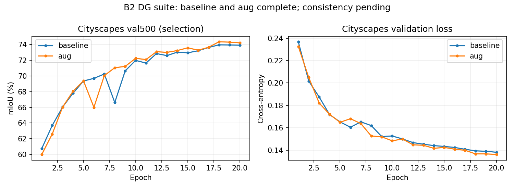

# B2 DG · seed42 · hai nhánh hoàn thành

Nghiệm thu22/11/2026 từ `dg_segformer_b2_suite_seed42.zip`. [Record kiểm tra](verification.json) · [CSV đường học](learning_curves.csv) · [Train/resume](../../docs/TRAINING_GUIDE.md).

| Nhánh | Epoch hoàn thành | Best epoch | Cityscapes val500 mIoU | Train + validation ghi trong log |
| --- | ---: | ---: | ---: | ---: |
| baseline | 20/20 | 18 | 73,98% | 3,27giờ |
| aug | 20/20 | 18 | 74,37% | 4,52giờ |
| consistency | 0/20 | — | Chưa có | Chưa chạy |

Aug hơn baseline **0,394 điểm phần trăm** trên Cityscapes val dùng chọn checkpoint. Cả hai có cùng hash khởi tạo ImageNet/head, seed42, train2975/val500 và20epoch. Đây là một seed trên tập selection; chưa chứng minh cải thiện thời tiết xấu, độ ổn định thống kê hoặc vượt bài báo. Chưa đánh giá ACDC và chưa đủ sáu candidate để freeze cohort.



## Vì sao consistency chưa chạy?

Suite ghi `session_checkpoint_ready` sau9,34giờ của invocation, không có `failure.json`. Hai nhánh đầu đủ20epoch; consistency đã có config nhưng chưa có checkpoint epoch1. Không phải lỗi bỏ consistency khỏi lịch.

Runner dành tối đa10giờ mỗi phiên, trừ thời gian notebook setup. Trước nhánh chưa có timing lịch sử, nó dự phòng40phút/epoch ×1,5 +15phút =75phút. Thời gian còn lại không đủ nên lưu và dừng. Đây là cửa sổ do code đặt, khác quota30giờ chung của tài khoản Kaggle.

GPU profile đo TeslaT4, PyTorch2.11.0+cu130; ước tính consistency20epoch khoảng5,24giờ, **chưa gồm đầy đủ setup/process startup/checkpoint/ZIP**. Hai nhánh đã chạy có median9,80/13,56phút mỗi epoch, peak allocated khoảng5,21GiB. Toàn invocation9,34giờ gồm overhead ngoài train/validation; không dùng tổng này làm timing thuần của model.

## Kiểm tra artifact

- Toàn bộ3.560entry ZIP đọc hết và qua CRC; không giải nén toàn bộ dataset, không chạy source nhúng.
- 272hash source trong bốn snapshot và24hash file thuộc tám generation checkpoint đều khớp.
- Log/history/resources của hai nhánh đủ epoch1–20; global_step khớp tổng optimizer updates; best epoch khớp mIoU cao nhất.
- Manifest đủ2.975train/500val, chỉ Cityscapes; các bản CSV của ba nhánh giống nhau và hash đúng plan.
- Hash initial weights của baseline/aug giống nhau. Hash best/config/frozen candidate/profile seal đều khớp.
- Config và snapshot code khớp source local tại thời điểm kiểm tra. Chưa deserialize training_state hoặc chạy inference mới; các file trạng thái đã được kiểm hash.

## Tiếp tục

Mở phiên Kaggle mới, dùng notebook B2 hiện hành, thêm ZIP kết quả này hoặc thư mục đã giải nén và **giữ nguyên Cityscapes version/mount**:

```python
RESUME_INPUT = Path('/kaggle/input/<dataset-ket-qua-B2>')
```

Thay placeholder bằng đường dẫn input thực tế. Notebook lấy snapshot code từ ZIP; baseline/aug đã hoàn thành được xác minh rồi bỏ qua, consistency chạy từ epoch1 với khởi tạo độc lập. Không dùng best của aug để học nối consistency. Khi hoàn thành, tải ZIP suite mới; `suite_complete` và3/3nhánh mới là hoàn thành B2.
