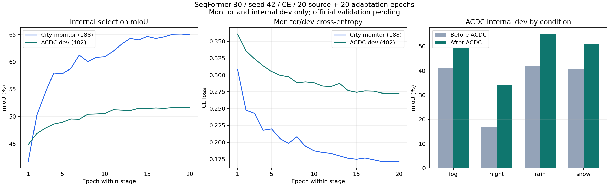

> **Lịch sử supervised, không phải DG hiện hành.** Run này học cả ảnh và nhãn ACDC. Các số liệu dưới giữ nguyên để truy vết; hướng chạy tiếp theo ở [kế hoạch DG](../../research/PROJECT_COMPLETION_PLAN.md).

# SegFormer-B0 — seed 42, CE control

[Results index](../README.md) · [Integrity checks](verification.json) · [Per-class ACDC dev scores](acdc_dev_classes.csv)

## Training completed

Run received as `segformer_b0_seed42.zip`: both stages completed all 20 epochs, with 40 result snapshots. Recorded training invocation took **4.39 hours** on a Tesla T4, including in-run validation and packaging; notebook dependency/data setup is additional.

The frozen source snapshot matches the current implementation. The source stage starts from an ImageNet encoder with a new 19-class segmentation head. Adaptation loads this run's source best checkpoint, then learns labeled ACDC with Cityscapes replay at 1:1. Both stages use CE, seed 42 and the fixed 20-epoch horizon.

| Internal selection set | Before adaptation | After adaptation | Change |
| --- | ---: | ---: | ---: |
| ACDC dev, 402 images | 37.84% | 51.65% | +13.82 percentage points |
| Cityscapes monitor, 188 images | 65.13% | 65.16% | +0.03 percentage points |

The source checkpoint is **epoch 19**; the adaptation checkpoint is **epoch 20** and passes the source-retention gate. The +0.03-point Cityscapes change is very small and is not evidence of a statistically meaningful improvement.

## Weather conditions on the same ACDC dev split

| Condition | Images | Before | After |
| --- | ---: | ---: | ---: |
| Fog | 81 | 40.98% | 49.50% |
| Night | 93 | 16.89% | 34.20% |
| Rain | 154 | 42.07% | 54.92% |
| Snow | 74 | 40.82% | 50.84% |

## Interpretation and next step

ACDC dev mIoU increases while dev CE generally decreases. Gains become small near the end: epoch 15 to 20 adds about 0.18 percentage points. These curves show no sustained dev deterioration, but do not prove the absence of overfitting. The train-eval probes contain only 16 source images or 8 replay images; their train/dev gaps are not representative generalization estimates.

Night remains the hardest condition. The lowest aggregate class IoUs are motorcycle (8.69%), bus (17.49%) and rider (19.86%). Low IoU alone does not establish class imbalance as the cause. Keep this CE control fixed; inspect per-class errors after completing the comparable model runs, then test targeted loss/crop changes as separate ablations.

The follow-up supervised campaign originally proposed here has been retired. Current work trains B2/DeepLab independently under the Cityscapes-only DG protocol; see the [current plan](../../research/PROJECT_COMPLETION_PLAN.md). Keep the measurements in this report as historical evidence.

**Official validation is pending.** The numbers above are internal monitor/dev results used during model selection, from one seed. They do not establish superiority over published papers or independent-test generalization.

## Artifact verification

- ZIP CRC, frozen source hashes, data/config hashes and generated manifest hashes pass.
- All eight checkpoint generations pass the 24 recorded file-hash checks; no history/resource epoch gaps or duplicates.
- Adaptation's initialization hash matches the source best checkpoint.
- Source and adapted best weights are retained locally under the Git-ignored `outputs/reviews/segformer_b0_seed42/`. These exports support inference/evaluation; the original ZIP retains the full training state for resume.
- The report, plot and class-score CSV are small review artifacts. Weights, datasets and the original ZIP remain outside Git.
