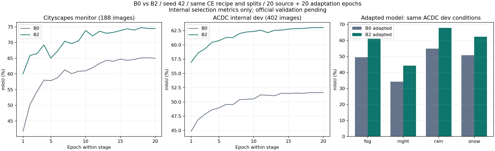
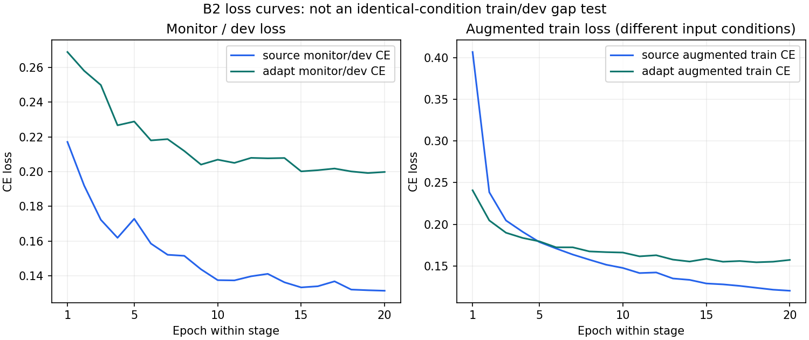

# SegFormer-B2 — seed 42, CE control

[Results index](../README.md) · [Integrity and comparability checks](verification.json) · [Per-class scores](acdc_dev_classes.csv) · [Curve data](learning_curves.csv)

## Training completed

Both stages completed all 20 epochs, with 40 result snapshots. The recorded invocation took **7.77 hours (7 h 46 min)** on a Tesla T4, including in-run validation and ZIP export; dependency/data setup is additional. This replaces the earlier conservative B2 planning range for this observed run, without guaranteeing other hardware/session timings.

Best source checkpoint: **epoch 18**. Best adapted checkpoint: **epoch 20**, passing the source-retention gate.

| Internal selection set | Before B2 adaptation | After B2 adaptation | Change |
| --- | ---: | ---: | ---: |
| ACDC dev, 402 images | 48.44% | 63.02% | +14.58 percentage points |
| Cityscapes monitor, 188 images | 74.74% | 74.53% | −0.21 percentage points |

The source drop remains below the configured 1-percentage-point limit. These are internal checkpoint-selection scores. **Official Cityscapes val 500 and ACDC val 406 remain pending.**

## Comparison with the fresh B0 control

| Metric | B0 | B2 | B2 − B0 |
| --- | ---: | ---: | ---: |
| Parameters | 3,719,027 | 27,361,235 | Different model capacity |
| Best source: Cityscapes monitor | 65.13% | 74.74% | +9.61 pp |
| Adapted: Cityscapes monitor | 65.16% | 74.53% | +9.37 pp |
| Adapted: ACDC dev | 51.65% | 63.02% | +11.37 pp |
| Recorded invocation | 4.39 h | 7.77 h | Different training compute |

Comparability checks confirm identical frozen code, the same seed, CE, epochs, LR/batch/normalization/augmentation/selection policies, the same nine manifests after normalizing model-specific workspace paths, and byte-identical converted labels for all 2,975 Cityscapes training images. Each model starts from its corresponding ImageNet encoder and a new head. This is a same-recipe model comparison; architecture, encoder initialization and compute differ, so the gain cannot be attributed to parameter count alone.

| ACDC dev condition | Images | B2 before adaptation | B0 adapted | B2 adapted |
| --- | ---: | ---: | ---: | ---: |
| Fog | 81 | 54.25% | 49.50% | 61.48% |
| Night | 93 | 22.85% | 34.20% | 44.29% |
| Rain | 154 | 53.59% | 54.92% | 67.88% |
| Snow | 74 | 51.75% | 50.84% | 62.34% |

All 19 aggregate class IoUs are higher than B0 in this run. The weakest B2 classes remain rider (28.09%), motorcycle (29.07%) and bus (32.03%). Night is still the weakest condition. Neither low IoU nor this single comparison establishes class imbalance as the cause.

## Learning behavior and next step

Monitor/dev CE generally decreases and there is no sustained dev-mIoU deterioration. Gains taper: adaptation epoch 15 to 20 adds approximately 0.26 percentage points; epoch 19 to 20 adds only 0.0016 points. A best epoch at the horizon is not sufficient evidence to extend training or increase LR.

These curves do not prove the absence of overfitting. Augmented training CE and monitor/dev CE use different input conditions, and train-eval probes are small. One seed and internal model-selection sets do not support statistical superiority or published-benchmark claims.

Keep the B0 and B2 source/adapted checkpoints frozen. Complete the DeepLabV3+ ResNet50 CE control with the same 20 + 20 recipe before changing augmentation or loss. Then use the shared evaluator for frozen candidates on the official validation splits. Augmentation experiments should remain separate ablations; none was added to this run or to the source code during this review.

## Artifact checks

- Outer ZIP and frozen source ZIP CRC pass; source/config/manifest hashes pass.
- Eight checkpoint generations pass all 24 recorded file hashes. Histories and resource logs each contain epochs 1–20 exactly once per stage.
- Adaptation initialization matches the B2 source-best weights hash.
- Best-checkpoint epochs agree with the recorded selection rule. Primary losses and metrics are finite; both best checkpoints pass strict local loading and a 19-class CPU forward smoke check.
- Median epoch time: source **8.36 min**, adaptation **10.24 min**; these exclude ZIP/setup overhead. Peak PyTorch allocated memory is approximately **5.20 GiB**; reserved memory approximately **5.96 GiB**. These are allocator measurements, not total GPU memory usage.
- Inference/evaluation exports are local under Git-ignored `outputs/reviews/segformer_b2_seed42/`. They omit optimizer/RNG state; the original ZIP retains full resume state. No weights, dataset images or result ZIP are committed.
