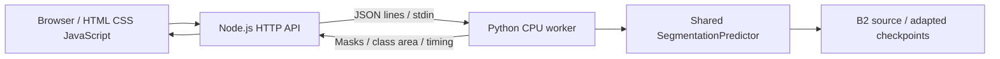

> **Historical demo, not DG evidence:** source is the old Cityscapes-only run; adapted checkpoints used ACDC images/labels. DG baseline/proposed results are pending. [Recovery plan](../research/DG_RECOVERY_PLAN.md).

# WeatherLens Studio

Local web interface for Project-CV, served by **Node.js**. A persistent Python worker runs the existing trained PyTorch models on CPU. Training, preprocessing and model architectures are reused unchanged. No Streamlit or JavaScript model conversion is required.



## Start

Requirements: Node.js 22+, Python environment from the project `requirements.txt`, and trained checkpoints. From the repository root:

```bash
python -m pip install -r requirements.txt
npm start
```

Open **http://127.0.0.1:3000**. Runtime uses Node built-ins, so `npm install` is only needed for browser-test development dependencies. The server chooses `.venv/Scripts/python.exe` on Windows or `.venv/bin/python` on Linux when present. Override with `PYTHON_BIN` if needed; `PORT` defaults to 3000. Bind is loopback only. Stop using Ctrl+C.

## Checkpoints and sample images

Default checkpoint layout, for B2:

```text
outputs/reviews/segformer_b2_seed42/
  source/config.json          # Run config, including preprocessing
  source/best/config.json     # Model config
  source/best/model.safetensors
  adapt/config.json
  adapt/best/config.json
  adapt/best/model.safetensors
```

For another machine, extract the corresponding `jobs/segformer_b2_source/run/` and `jobs/segformer_b2_adapt/run/` folders from the received result ZIP into the default layout above, or point environment variables to their `best/` folders:

```powershell
$env:SEGFORMER_B2_CHECKPOINT='D:/models/B2/adapt/best'
$env:SEGFORMER_B2_SOURCE_CHECKPOINT='D:/models/B2/source/best'
$env:PYTHON_BIN='D:/python/Project-CV/.venv/Scripts/python.exe'
npm start
```

On Linux, use `export VARIABLE='/path'`. Paths are configured by the server operator, never accepted as arbitrary browser request paths. Model safetensors hashes are checked against the accepted report when a model is first loaded. Keep reports and checkpoints paired; a different run requires its own accepted report.

Sample images are discovered from `data/raw/cityscapes/leftImg8bit/val` and `data/raw/ACDC/rgb_anon_trainvaltest/rgb_anon/{fog,rain,snow,night}/val`. Override roots with `CITYSCAPES_ROOT` and `ACDC_ROOT`. A clone without datasets still supports user uploads. A clone without checkpoints shows unavailable model choices and cannot perform inference. DeepLab is marked as awaiting training.

## Use

1. Pick a sample or upload/drop a PNG, JPG, WebP or BMP (up to 10 MB / 8 million pixels).
2. Select B2 and the source-only or ACDC-adapted checkpoint. Run segmentation.
3. Switch between original, color mask and overlay; adjust mask opacity.
4. Use before/after comparison to run both B2 checkpoint stages on the same input. The selected model controls the class-area legend and downloads.
5. Download native-sized trainId PNG (0–18), color mask or the overlay at the selected opacity.

Class percentages are **predicted pixel coverage**, not confidence or accuracy. Displayed ACDC dev mIoUs describe the internal 402-image set, not the uploaded image. No image-level accuracy is claimed without ground truth. CPU time reports include image preparation and output creation but exclude model load; cold-load status is shown separately. Comparison is sequential and caches results per image/model/stage.

Uploads are handled in memory, not stored in an upload history. One resident model and a bounded request queue limit memory/concurrency. Changing the image invalidates previous outputs; changing stage selects the cached result for that exact model/stage if available. Dataset samples, weights, screenshots and browser traces stay Git-ignored under `outputs/`; do not publish dataset images with the source.

## Code map

| File | Purpose |
| --- | --- |
| `server.mjs` | Static UI and HTTP API, upload limits, worker bridge |
| `worker.py` | Checkpoint discovery, verified model loading, image decode/inference |
| `public/index.html` | Accessible interface and dialogs |
| `public/styles.css` | Responsive layout and visual design |
| `public/app.js` | Upload, inference state, comparison, opacity and downloads |
| `../src/inference.py` | Shared native-resolution PyTorch inference |

## Verify

```bash
npm test
python -m pytest -q tests/test_web_worker.py tests/test_inference.py
npm install
# With npm start running and local checkpoints/datasets present:
npm run test:e2e
```

Browser tests use installed Chrome by default (`PLAYWRIGHT_CHANNEL=chrome`). They exercise real local B2 source/adapt inference, same-image comparison, changing images/stages, invalid uploads, downloading label PNGs and a 390px mobile layout. Desktop/mobile screenshots are written to `outputs/web-studio/`. Tests require both accepted checkpoints and the five sample conditions; unit/API tests do not require weights or datasets.

This is a local research/demo server. It does not expose training controls or modify a run, and it has no hosted deployment or user-account system.
